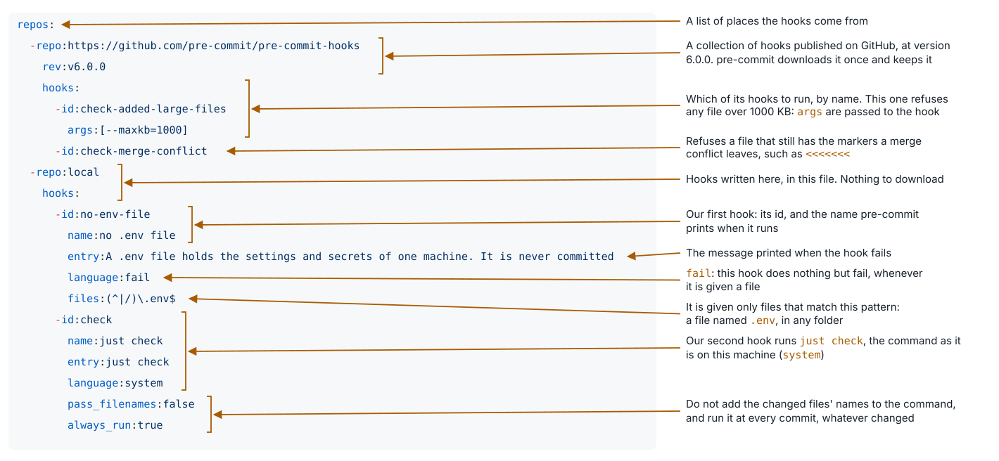

## Types in every signature

- A type annotation says what a parameter takes and what a function returns, as in
  `def round_prob(x: float) -> float`
- Python does not check annotations when it runs. A reader does, and so does a type checker
- The family `ANN` of ruff asks for an annotation on every parameter and every return value
- A function that returns nothing says so, with `-> None`
- ruff can write `-> None` itself. Where it cannot guess a type, a person writes it

---

## A docstring on every public name

- A docstring is the string on the first line of a module, a class or a function. `help()` and the editor
  show it
- The rules `D1` of ruff ask for a docstring on every public module, class and function. A name that starts
  with `_` is private, and needs none
- ruff cannot write a docstring. Only a person knows what the code is for

---

## The 26 that need a person

The code and the tests of `tut-08`, under the rules `ANN` and `D1`:

| After | Findings |
|---|---|
| the files as they were | 57 |
| `just lint --fix --unsafe-fixes` | 26 |
| a person | 0 |

- ruff wrote `-> None` on the 31 functions that return nothing. It can be sure of `None`, and of no other type
- A person wrote the 14 types of the parameters of the tests, such as `pytest.MonkeyPatch`
- A person wrote 8 docstrings, for four classes, three functions and the package
- A person wrote 3 return types, of `to_record`, of `cheese_request` and `-> Self` of `_check`, and `*words: str`

---

## One command for every check, and git runs it

- The project has four checks, the format, the linter, the tests and the config files. A person forgets one, sooner or later
- `just check` runs them all, one after another, and stops at the first that fails
- git can run a program before each commit, a **hook**. If the program fails, git makes no commit
- pre-commit installs the hook, and runs the hooks that `.pre-commit-config.yaml` names
- **The hook runs `just check`**, so the hook and the terminal run the same thing
- A few more hooks keep out a large file, the markers of a merge conflict and a `.env` file

---

## What `just hook` writes

`just hook` runs `pre-commit install`, which writes one file, `.git/hooks/pre-commit`:

```bash
#!/usr/bin/env bash
# File generated by pre-commit: https://pre-commit.com
INSTALL_PYTHON=.../babykev/.venv/bin/python3
ARGS=(hook-impl --config=.pre-commit-config.yaml --hook-type=pre-commit)
...
if [ -x "$INSTALL_PYTHON" ]; then
    exec "$INSTALL_PYTHON" -mpre_commit "${ARGS[@]}"
```

- Before each commit, git looks in `.git/hooks/` for a file named `pre-commit`, and runs it
- The file only hands over to pre-commit, from the `.venv` of this clone
- git does not track `.git/hooks/`, so each clone runs `just hook` once. `just setup` never touches git

---

## Other moments when git runs a hook

| Hook | When git runs it | What it is for |
|---|---|---|
| `pre-commit` | before a commit | refuse what must not go in. **Ours** |
| `commit-msg` | on the message, before the commit | ask for a shape of the message |
| `pre-push` | before a push | checks too slow for every commit |
| `post-checkout`, `post-merge` | after a move to another commit | follow the move, for example update the environment |

A hook is like a callback in a training loop. It is code that runs at a set moment. We use one, `pre-commit`.

---

## The config of the hook, line by line



---

## The files that are not Python

The tests and the linter read the Python. The config files need checks of their own:

| Check | The file it reads | A new package? |
|---|---|---|
| `validate-pyproject pyproject.toml` | `pyproject.toml`, against its standard | yes |
| `uv lock --check` | `uv.lock`, against `pyproject.toml` | no, uv has it |
| `just --fmt --check --unstable` | the `justfile` | no, just has it |
| `yamllint --strict .` | every YAML file, such as `.pre-commit-config.yaml` | yes |

- A broken `.pre-commit-config.yaml` breaks every commit, and nothing in Python sees it
- Each check is one command, and the lecture runs each one by hand first

---

## yamllint and its settings

```yaml
# The settings of yamllint, which checks every YAML file of the project
extends: default
ignore-from-file: .gitignore  # the files that git ignores, such as everything in .venv
rules:
  document-start: disable  # a file need not start with a line of three dashes
  line-length: {max: 100}  # as long as a line of the Python code
```

- On its defaults, yamllint read `.venv` too, asked for `---` at the top of each file, and allowed 80 characters
- Each setting answers one of those findings. None of them was made up to show the tool
- `--strict` makes a warning fail, as an error does

---

## validate-pyproject: checks `pyproject.toml`

- `pyproject.toml` has a format that a standard writes down. It says which sections there are, which keys each
  may hold, and what kind of value each key takes
- `validate-pyproject pyproject.toml` checks the file against the standard. When all is well, it prints
  `Valid file: pyproject.toml`
- Write the key `requires_python` in place of `requires-python`, and the check fails. The first and the last line
  of what it prints are below

```
[ERROR] `project` must not contain {'requires_python'} properties
...
Invalid file: pyproject.toml
```

---

## `uv lock --check`: is the lockfile up to date?

- No new package is needed, because uv has the check. `--check` compares `uv.lock` with `pyproject.toml`, and
  changes nothing
- When the two agree, it prints `Resolved 29 packages`
- Write `"pydantic>=2.14"` in place of `"pydantic>=2.14.1"` in `pyproject.toml`, and do not run `uv lock`. The
  check then fails, and prints the lines below

```
error: The lockfile at `uv.lock` needs to be updated, but `--check` was provided.

hint: To update the lockfile, run `uv lock`.
```

The justfile exports `UV_LOCKED`, so every recipe that runs uv refuses such a lockfile too.

---

## `just --fmt --check`: is the justfile formatted?

- No new package is needed, because just has its own formatter. just still marks the formatter as unstable, so
  the command needs `--unstable`
- When the justfile is formatted, it prints nothing
- Write `program:="babykev"`, with no spaces, and it prints the justfile as a diff of 78 lines. Two of them carry
  the change, and the last says why the check failed

```
-program:="babykev"
+program := "babykev"
...
error: Formatted justfile differs from original.
```
