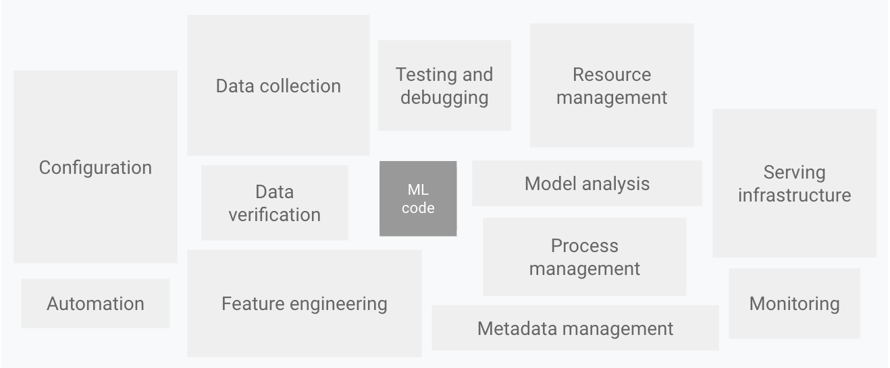
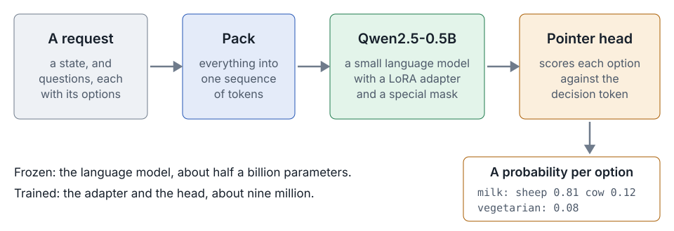

<h1 style="text-align: center">SOFTWARE DEVELOPMENT</h1>
<h1 style="text-align: center">FOR</h1>
<h1 style="text-align: center">MACHINE LEARNING</h1>

<div style="text-align: center">

## *Rahul Dave*

</div>

---


---


---

## The parts of a machine-learning project

| | |
|---|---|
| Design | <u>Setup</u>, Product, <u>Systems</u> |
| Data | Preparation, Exploration, Preprocessing, Distributed |
| Model | Training, Tracking, Tuning, Evaluation, Serving |
| <u>Developing</u> | <u>Scripting</u>, <u>CLI</u> |
| Utilities | Logging, <u>Documentation</u>, <u>Styling</u>, <u>Pre-commit</u> |
| <u>Testing</u> | <u>Code</u>, Data, <u>Models</u> |
| Reproducibility | <u>Versioning</u> |
| Production | <u>Jobs & Services</u>, <u>CI/CD workflows</u>, Monitoring, Data engineering |

The table has 26 parts. The rows Data and Model hold nine of them, and the rest are engineering. This class covers
the underlined parts.

---

## The ML code is a small box



Google Cloud, *MLOps: continuous delivery and automation pipelines in machine learning*, after Sculley et al., *Hidden technical debt in machine learning systems*, NeurIPS 2015

---

## The parts of a software project

| | |
|---|---|
| Source | Version control, Code review |
| Environment | <u>One known Python</u>, <u>every dependency pinned</u>, <u>one way to run anything</u> |
| Code | <u>A package</u>, <u>a command-line interface</u>, <u>types</u>, <u>docstrings</u> |
| Quality | <u>Formatting</u>, <u>linting</u>, <u>type checking</u> |
| Tests | <u>Unit tests</u>, <u>property tests</u>, <u>integration tests</u>, <u>system tests</u>, <u>coverage</u> |
| Documentation | <u>Reference built from code</u>, <u>guides</u>, <u>a site</u> |
| Automation | <u>Hooks on dev</u>, <u>continuous integration</u>, <u>builds</u> |
| Shipping | <u>Containers</u>, packaging for others, releases, deployment |
| Running | Logging, monitoring, someone on call |

A machine-learning project is a software project with a model and data in it.

---

## The steps of the tutorial

| Step | What it adds | Tools |
|---|---|---|
| tut-01 | The project, its command and its justfile | **uv**, **just** |
| tut-02 | Tests of the command, and coverage | **pytest**, **pytest-cov** |
| tut-03 | The contract, `api.py`, from the project kev | **pydantic** |
| tut-04 | Tests of what a request is | **pytest** |
| tut-05 | Tests of the text that the model reads, and of the answers made from its probabilities | **pytest** |
| tut-06 | Two bugs of kev, each found by a test and then fixed | **pytest** |
| tut-07 to tut-10 | One format, a linter, a type in every signature, a docstring on every public name | **ruff** |
| tut-11 | `just check`, and a git hook that runs it before each commit | **pre-commit** |
| tut-12 | Checks of the config files | **validate-pyproject**, **yamllint** |
| tut-13, tut-14 | Documentation in the code, its check, and a site built from it | **smalldocs** |
<<<<<<< HEAD
| tut-15 to tut-17 | The packages of the model, `model.py` from kev, and a type checker | **torch**, **transformers**, **peft**, **ty** |
| tut-18 | A smoke run of the real model | **torch** |
| tut-19 to tut-21 | A tiny model, fixtures, tests of the model, and a floor on coverage | **pytest** |
| Later | The mask, found and fixed, a system test, Docker images, checks and docs on GitHub | **hypothesis**, **Docker**, **GitHub Actions** |
=======
| tut-15 to tut-17 | The packages of the model, the model of kev, and a type checker | **torch**, **transformers**, **peft**, **ty** |
| tut-18 | The smoke run, on the real model | **the Hugging Face Hub** |
| tut-19 to tut-21 | A tiny model, unit tests and integration tests, and a floor of coverage | **pytest** |
| tut-22 | The mask, found by its tests and fixed | **hypothesis** |
| tut-23 | The system test, which the gate leaves out | **pytest** |
| tut-24 | Two pages of the docs on the model | **smalldocs** |
| tut-25 | Two images, built from the lockfile | **Docker**, **hadolint** |
| tut-26 | The gate and the docs, on GitHub | **GitHub Actions**, **actionlint** |
>>>>>>> tut-22

---

# babykev

A small model that makes decisions, and the project built around it.

- The model comes from kev, by Jared Palmer.
- We start from the first commit of kev. It has about 830 lines that work, one test that needs a running server, no types and no docs.
- We build the project again in steps, and bring in the files of kev one at a time.
- Each step brings a new tool. We learn about the tool, and we run it.
- Each tool gets a recipe in the justfile, so the project has one interface.

---

## The second example: the cheese app


[github.com/dlops-io/cheese-app-ci-cd](https://github.com/dlops-io/cheese-app-ci-cd)

A FastAPI app with linters, formatters, tests and pre-commit hooks. It uses Docker in every step.

---

## One request, one answer

```yaml
state: "Roquefort is a semi-soft, blue-veined cheese from France. It tastes sharp, tangy and salty."
questions:
  milk:       {type: choice, criteria: {cow: …, goat: …, sheep: …, buffalo: …, mixed: …}}
  vegetarian: {type: noul}      # yes or no
  intensity:  {type: score, criteria: [mild, medium, pronounced, strong]}
```

```yaml
milk:       {choice: sheep, confidence: 0.81}
vegetarian: {noul: 0.08}
intensity:  {score: 2.7}
```

The state is the text that the questions are about. It is also called the context. The model gives a probability
for every option, and generates no text.

---

## A model that decides



The model reads all the questions in one sequence. A mask keeps each question from seeing the others.

---

## You install two tools, and the project installs the rest

| Tool | For |
|---|---|
| **uv** | Python itself, every dependency, running the program |
| **just** | The recipes of the project. `just` lists them |

The lockfile is a file that uv writes, and it names every other tool with its exact version. In this tutorial it gains pytest, pytest-cov and pydantic, and later steps add
tools such as ruff, smalldocs and torch. `just setup` installs everything that the lockfile names.

---

## The files of kev, one at a time

| File in the first commit of kev | Lines | What it does | Arrives at |
|---|---|---|---|
| `api.py` | 111 | The contract: what a request and an answer look like | tut-03 |
| `model.py` | 101 | Packing, the mask, the pointer head | tut-16 |
| `data.py`, `train.py`, `evaluate.py` | 446 | Training records, the loop, accuracy and calibration | The class on training |
| `serve.py` | 170 | Inference | The class on CI/CD with GitHub Actions |
