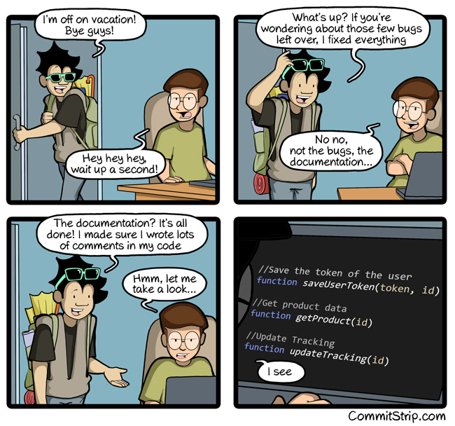

## Documentation, just before a holiday



CommitStrip, *Documentation just before vacation*, 27 July 2016, commitstrip.com

---

## Types and docs, written once

```python
def line_of(
    sym: Code,  # A function, method or class
) -> int:  # The line its definition starts on
    """Find the line a symbol's definition starts on, to keep symbols in source order."""
```

- The **type** is in the signature
- The **meaning** is in a comment beside each parameter and beside the return, a **docment**
- The **docstring** says what the function is for
- smalldocs reads all three, and writes the reference. Nothing is written twice, so nothing can disagree

---

## The gaps

`just docs check` holds every function, method and class to one rule. It asks for a docment on every parameter and
on the return, a docstring, and a description on every field of a pydantic model.

| File | Complete |
|---|---|
| `babykev.api` | 0 of 12 |
| `babykev.cli` | 1 of 1 |
| `tests/unit/test_api.py` | 23 of 29 |
| `tests/unit/test_cli.py` | 0 of 3 |

- 24 of 45, and 46 gaps. The linter asks already for the types and the docstrings
- So the gaps are the docments, the descriptions of the fields, and the docstring of a private method
- Like coverage, the check counts. Coverage counts the lines that the tests run, and the check counts what has
  documentation

---

## Docments and the formatter

- The formatter keeps a comment on its line, so a docment survives `just fmt`
- A line of more than 100 characters can lose one. The formatter splits the line, and the comment lands away
  from what it describes
- The linter and the formatter are then happy. Only the docs check sees the lost docment
- So a docment is one short line, and the docstring holds the rest

---

## The site, from the same text

- `just docs` builds the site into `docs/_site`, with smalldocs
- Each build writes the reference pages from the code first. git ignores what the build makes
- A front page, written by hand, says what the project is
- A name in backticks, such as `to_answers`, becomes a link to its entry
