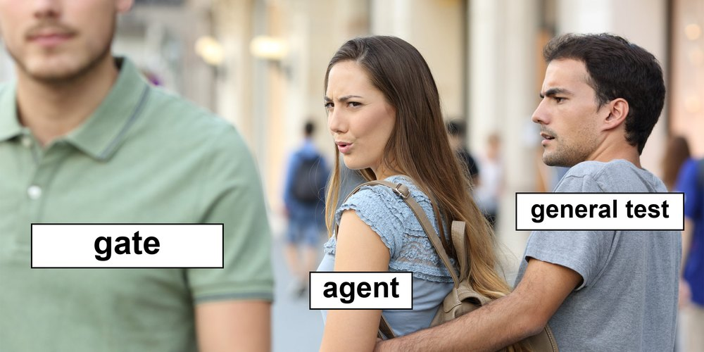

## One command for every check, and git runs it

- The project has three checks, the format, the linter and the tests. A person forgets one, sooner or later
- `just check` runs them all, one after another, and stops at the first that fails
- git can run a program before each commit, a **hook**. If the program fails, git makes no commit
- pre-commit installs the hook, and runs the hooks that `.pre-commit-config.yaml` names
- **The hook runs `just check`**, so the hook and the terminal run the same thing. A check that runs before every
  commit is a **gate**
- A few more hooks keep out a large file, the markers of a merge conflict and a `.env` file

---

## What `just hook` writes

`just hook` runs `pre-commit install`, which writes one file, `.git/hooks/pre-commit`:

```bash
#!/usr/bin/env bash
# File generated by pre-commit: https://pre-commit.com
INSTALL_PYTHON=.../babykev/.venv/bin/python3
ARGS=(hook-impl --config=.pre-commit-config.yaml --hook-type=pre-commit)
...
if [ -x "$INSTALL_PYTHON" ]; then
    exec "$INSTALL_PYTHON" -mpre_commit "${ARGS[@]}"
```

- Before each commit, git looks in `.git/hooks/` for a file named `pre-commit`, and runs it
- The file only hands over to pre-commit, from the `.venv` of this clone
- git does not track `.git/hooks/`, so each clone runs `just hook` once. `just setup` never touches git

---

## Other moments when git runs a hook

| Hook | When git runs it | What it is for |
|---|---|---|
| `pre-commit` | before a commit | refuse what must not go in. **Ours** |
| `commit-msg` | on the message, before the commit | ask for a shape of the message |
| `pre-push` | before a push | checks too slow for every commit |
| `post-checkout`, `post-merge` | after a move to another commit | follow the move, for example update the environment |

A hook is like a callback in a training loop. It is code that runs at a set moment. We use one, `pre-commit`.

---

## You may even call it a gate



Distracted girlfriend, a widely shared stock photo (imgflip.com/memetemplate/118429510). The labels are ours

---

## The config of the hook, line by line


