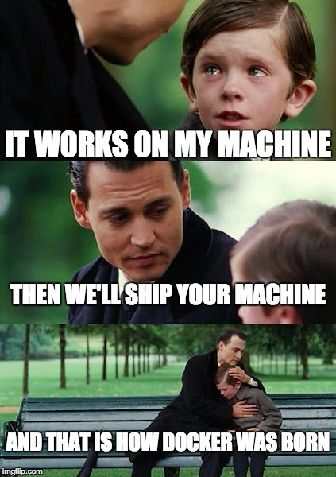

## Not everyone has a Mac

- Students run Windows, Linux, or a machine in the cloud
- The platforms that train a model run Linux, on machines of someone else
- An image is a Linux machine that one file describes, the `Dockerfile`. Docker runs it on any of these systems

---

## How Docker was born



A widely shared meme. Its author is unknown. imgflip.com/i/24ac74

---

## The run image is built in stages

```dockerfile
FROM ghcr.io/astral-sh/uv:0.12.13 AS uv

FROM python:3.13-slim-trixie AS build
COPY pyproject.toml uv.lock .python-version ./
RUN uv sync --locked --no-default-groups --no-install-project
COPY src ./src
RUN uv sync --locked --no-default-groups --no-editable

FROM python:3.13-slim-trixie AS run
COPY --from=build /opt/venv /opt/venv
ENTRYPOINT ["babykev"]
```

- The packages come first and the code after, so a change to the code does not install torch again
- `docker build --target run` stops at the stage `run`, which has no uv and no tool of the developers
- About 1.1 GB. On the CPU of the container, the smoke gives the fifteen answers of `mps`

---

## Two images from one lockfile

| | dev | run |
|---|---|---|
| Holds | the whole project, every group, uv, just and git | the program and what it needs |
| Starts | a shell, with this folder at `/work` | `babykev` |
| For | working on the project on any system | a platform that runs the program |

The environment of each image is in `/opt/venv`, so a mounted folder keeps its `.venv` to itself.

---

## What a build never copies

| Dev image | The context that Docker reads | `/work/.venv` | The image |
|---|---|---|---|
| without `.dockerignore` | about 800 MB | about 800M, built for macOS | about 2.1 GB |
| with `.dockerignore` | a few kB | none | about 1.4 GB |

`.dockerignore` is to `docker build` what `.gitignore` is to git.

---

## `just image`

```
just image build dev                          docker build --target dev, named babykev-dev
just image shell                              a shell in the dev image, with this folder at /work
just image shell --network none -- just check every check, with no network
just image run smoke                          the smoke in the run image
```

- An image is a file on disk. A container is a running copy of it, and `--rm` removes it at the end
- An image holds the packages of the lockfile at the time of its build. Build it again after a change to `uv.lock`

---

## hadolint: a linter for Dockerfiles

```
$ uv run hadolint Dockerfile
Dockerfile:44 DL3008 warning: Pin versions in apt get install.
```

- DL3008 asks for the version of each package of Debian
- Debian removes the old version of a package at each fix of its security, so a pinned version stops building
- We decline the rule, and give the reason in a comment above the line
- A rule of a linter is a default, and not a law
