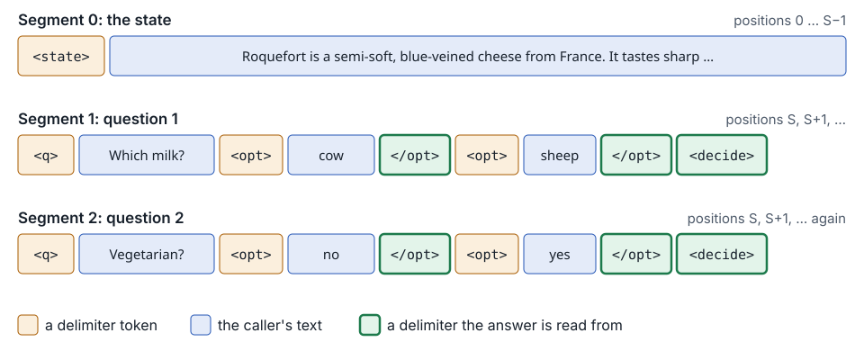
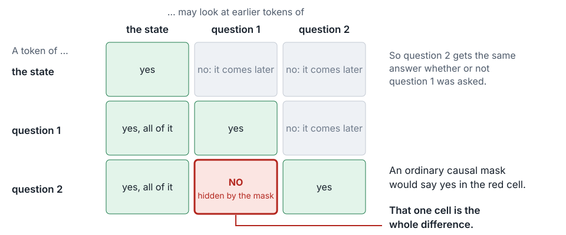
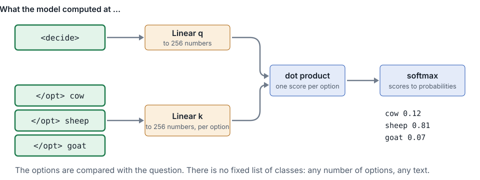

## The packages of the model

| Package | What it does for the model |
|---|---|
| torch | Tensors, and the arithmetic on them, on the CPU or on a GPU |
| transformers | The base model and its tokenizer, from the Hugging Face Hub |
| peft | A LoRA adapter: a few weights that learn, on top of a base model that stays as it is |
| safetensors | The format of the weights on the Hub |

- Each comes in by its own `uv add`
- torch comes in several builds. On Linux, the build on PyPI brings the libraries of CUDA, for the GPUs of NVIDIA
- So torch comes from an index of its own, the builds of PyTorch for the CPU, and it comes first

---

## torch, from its own index

```toml
[[tool.uv.index]]
name = "pytorch-cpu"
url = "https://download.pytorch.org/whl/cpu"
explicit = true

[tool.uv.sources]
torch = { index = "pytorch-cpu" }
```

- An **index** is a server of packages, as PyPI is
- `explicit = true`: uv takes from this index only what `[tool.uv.sources]` sends there. Every other package comes
  from PyPI
- `uv add torch --index pytorch-cpu` writes `[tool.uv.sources]`. For that one run, `--index` puts the index first for
  every package, so `--frozen` leaves `uv.lock` as it is
- peft needs torch. Added first, peft would bring torch from PyPI. So torch comes first

---

## `model.py`: four ideas

- **Pack** the state and every question into one sequence
- **Mask** it, so each question sees the state and itself, never another question
- **Restart the positions**, so every question sits right after the state
- **Point**: score each option against the question's decide token

One pass answers every question, as if each had been asked alone.

---

## Packing: one sequence for everything



Five delimiter tokens mark the parts. A caller's text can never make one.

---

## The mask, as designed: questions cannot see each other



```python
attend(i, j)  if  j <= i  and  (seg[j] == 0  or  seg[j] == seg[i])
```

---

## The pointer head: compare, do not classify



---

## Tidy is not tested

| File | Statements | Covered |
|---|---|---|
| `api.py` | 75 | 100% |
| `cli.py` | 8 | 100% |
| `model.py` | 109 | 0% |
| Total | 192 | 43% |

- `model.py` passes the format, the linter and the docs check, 60 of 60
- No test imports it, and coverage counts it still, because `--cov=babykev` names the whole package
- The gate has no floor yet, so it passes

---

## ty: a type checker

- Every function of babykev says the types that it takes and the type that it returns
- Python does not read them when it runs, and the linter only asks that they be there
- ty reads the code, without running it. It compares every call and every value with the types that the code and
  its libraries declare
- `ty check` runs it on the whole project. The recipe is `just types`, and the gate runs it

---

## Two findings, one cause

```python
class Module:                                           # torch/nn/modules/module.py
    forward: Callable[..., Any] = _forward_unimplemented   # line 526

class PointerHead(nn.Module):                           # src/babykev/model.py
    def forward(self, h_decide: Tensor, h_opts: Tensor) -> Tensor: ...
```

- `invalid-mutable-override`: code may write any function into `forward` of a `Module`, and the method of
  `PointerHead` accepts fewer calls
- The same holds for `DecisionModel`, so ty finds two
- torch only calls `forward`, from `__call__`, and never writes it. The rule is right in general, and does not fit here

---

## A rule off, on one line, with its reason

```python
    # nn.Module declares forward as an attribute that may hold any function. A method with two
    # tensors accepts fewer calls, so ty refuses it. torch only calls forward, and never sets it
    def forward(  # ty: ignore[invalid-mutable-override]
```

- The comment names one rule, and holds for one line. Every other rule still checks the line
- The rule still guards every other class of the project
- The reason sits above it, for the next reader
